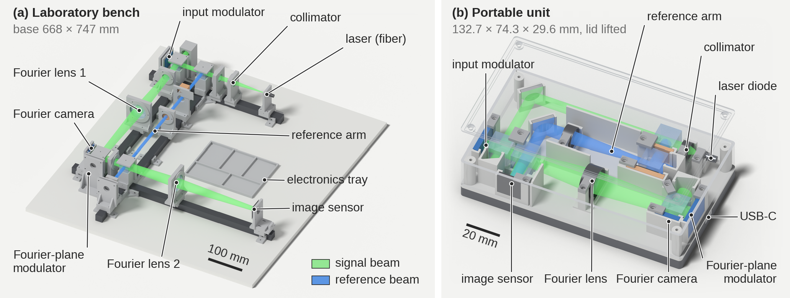

# Asymmetric Optical Image Watermarking: Hardware Design Files

**Guang Yang** (University of California, Los Angeles)

Paper: [arXiv:2611.23350](https://arxiv.org/abs/2611.23350)

> **Status.** Design files only. No hardware was built or measured. The designs are derived from the simulated parameters of the paper and are provided as a starting point; they have not been validated.

## Overview

This repository holds the hardware design files of the two reference designs of the paper "Asymmetric Optical Image Watermarking". The paper studies a two-layer image watermark in which the Fourier transform at the core of the pipeline is performed by a coherent optical 4F unit. Layer 1 carries an Ed25519 signature bound to the image content in Fourier magnitudes, so anyone with the public key can verify it offline. Layer 2 is a key-defined carrier written by a secret phase hologram and read by a matched-filter correlator. The two designs here turn the simulated optical parameters into concrete geometry: a laboratory bench and a portable unit. For each design the repository gives the OpenSCAD sources, the exported STL files, renders, and a bill of materials.



*Reference hardware designs, rendered from the CAD models. (a) Laboratory bench with printed mounts on slotted rails; the enclosure is not shown. (b) Portable unit with the lid lifted.*

## Repository layout

```
README.md  LICENSE  CITATION.cff
lab-bench/
  scad/      OpenSCAD sources
  stl/       exported meshes, one file per printed part
  renders/   views of the assembly and of the parts
  BOM.md     bill of materials
portable-unit/
  scad/  stl/  renders/  BOM.md
docs/        device figure and optical layouts (PDF and PNG)
```

## Laboratory bench

**What it is.** A coherent 4F bench for the signer layout of the paper. Printed mounts sit on carriers that ride on 20 x 20 mm slotted rails. The rails lie on a flat base board. The design wavelength is 532 nm. The two Fourier lenses have a focal length of 230.36 mm (4f = 921 mm). The bench holds three reflective modulator panels (input, Fourier-plane amplitude, reference-arm phase), two board cameras, a reference shutter, and a variable attenuator. Printed corner posts carry opaque sheet panels for a light-tight enclosure.

**Outer size.** Base board 668 x 747 mm. The optical axis is 80 mm above the base board. The enclosure posts are 130 mm high.

**Printed parts.** 25 part types. The assembly uses 24 of them in 84 instances.

| part | qty | part | qty |
|---|---|---|---|
| `rail_carrier` | 18 | `camera_mount_fixed` | 1 |
| `rail_foot` | 18 | `stop_cap` | 1 |
| `corner_bracket` | 5 | `camera_slide_base` | 1 |
| `lens_holder_50` | 2 | `camera_slide_carriage` | 1 |
| `retaining_ring_50` | 2 | `fiber_holder` | 1 |
| `lens_holder_25` | 5 | `laser_vblock` (alternative to `fiber_holder`) | 0 |
| `retaining_ring_25` | 5 | `shutter_bracket` | 1 |
| `lens_holder_12` | 1 | `shutter_flag` | 1 |
| `retaining_ring_12` | 1 | `beam_dump` | 1 |
| `cube_table` | 4 | `enclosure_post` | 4 |
| `cube_clamp` | 4 | `electronics_tray` | 1 |
| `panel_frame_rail` | 2 | `panel_tilt_plate` | 3 |
| `panel_frame_board` | 1 | | |

**Bill of materials.** The full list is in [lab-bench/BOM.md](lab-bench/BOM.md). In short:

- Source and beam path: one single-frequency 532 nm laser with single-mode fiber output, one collimator (f = 100 mm), three linear polarizers, four 25.4 mm non-polarizing beam-splitter cubes, two 50.8 mm achromatic Fourier lenses.
- Modulators and cameras: one reflective LCOS panel at 8.0 um pitch (input), two reflective LCOS panels at 3.74 um pitch (amplitude and phase), two monochrome USB board cameras.
- Reference arm: micro servo shutter, variable attenuator, zero-order stop, annular stop.
- Structure: five slotted aluminum rails (387, 588, 369, 369, and 121 mm), one base board, opaque sheet panels.
- Electronics: powered USB hub, three display bridges, one USB microcontroller board.
- Fasteners: M5 T-nuts and screws, M3 screws and heat-set inserts, M2 and M2.5 screws.

**Layout.** See [docs/lab_bench_layout.pdf](docs/lab_bench_layout.pdf) for the top view and [docs/optical_layouts_unfolded.pdf](docs/optical_layouts_unfolded.pdf) for the unfolded optical layouts.

## Portable unit

**What it is.** A closed, USB-connected unit with the same optical functions. It uses a single Fourier lens in double pass with a reflective Fourier plane. The focal length is 55.09 mm. The source is a 520 nm laser diode. The splitter cubes have an edge of 12.7 mm. A one-piece printed chassis carries every seat, fence, baffle, and beam dump. A base tray under the optical deck holds one circuit board with a USB-C receptacle. A lid closes the unit.

**Outer size.** 132.7 x 74.3 x 29.6 mm.

**Printed parts.** 7 part types, 19 instances.

| part | qty |
|---|---|
| `chassis` | 1 |
| `lid` | 1 |
| `base_tray` | 1 |
| `pcb_spacer` | 4 |
| `tab_clamp_narrow` | 7 |
| `tab_clamp_wide` | 2 |
| `lens_clamp` | 3 |

**Bill of materials.** The full list is in [portable-unit/BOM.md](portable-unit/BOM.md). In short:

- Source and beam path: one single-mode 520 nm laser diode in a metal can, one collimator lens, five 12.7 mm non-polarizing splitter cubes, one Fourier lens and one reference lens (f = 55.09 mm each), two fold mirrors.
- Modulators and cameras: three reflective LCOS microdisplays at 3.74 um pitch (input, amplitude, phase), an annular stop, two board-level cameras.
- Reference arm: one flat liquid-crystal shutter / attenuator cell.
- Electronics: one circuit board under the optical deck, one USB-C receptacle. The circuit is not designed.
- Fasteners: 20 M2 countersunk self-tapping screws.

**Layout.** See [docs/portable_unit_layout.pdf](docs/portable_unit_layout.pdf).

## Rendering and exporting with OpenSCAD

The sources were exported with OpenSCAD 2021.01. Run the commands from the `scad/` directory of a design. Each design has an `export.scad` that selects one printable part with the variable `part`.

Export one part of the laboratory bench:

```
cd lab-bench/scad
openscad -D 'part="lens_holder_50"' -o ../stl/lens_holder_50.stl export.scad
```

Valid values of `part` for the laboratory bench: `rail_carrier`, `lens_holder_50`, `lens_holder_25`, `lens_holder_12`, `retaining_ring_50`, `retaining_ring_25`, `retaining_ring_12`, `cube_table`, `cube_clamp`, `panel_frame_rail`, `panel_frame_board`, `panel_tilt_plate`, `camera_mount_fixed`, `stop_cap`, `camera_slide_base`, `camera_slide_carriage`, `fiber_holder`, `laser_vblock`, `shutter_bracket`, `shutter_flag`, `beam_dump`, `rail_foot`, `corner_bracket`, `enclosure_post`, `electronics_tray`.

Export one part of the portable unit:

```
cd portable-unit/scad
openscad -D 'part="chassis"' -o ../stl/chassis.stl export.scad
```

Valid values of `part` for the portable unit: `chassis`, `lid`, `base_tray`, `pcb_spacer`, `tab_clamp_narrow`, `tab_clamp_wide`, `lens_clamp`.

Render views of the assemblies:

```
cd lab-bench/scad
openscad -o assembly_iso.png --imgsize=1500,1000 --projection=p --camera=214,-246,10,52,0,28,1950 --colorscheme=Tomorrow assembly.scad
openscad -o assembly_top.png --imgsize=1300,1450 --projection=o --camera=214,-246,0,0,0,0,2150 --colorscheme=Tomorrow assembly.scad
openscad --render -o parts_sheet.png --imgsize=1600,750 --projection=o --camera=345,95,25,56,0,18,1150 --colorscheme=Tomorrow parts_sheet.scad

cd portable-unit/scad
openscad -o open_iso.png --imgsize=1500,1000 --projection=p --camera=0,0,0,52,0,28,400 --autocenter --viewall --colorscheme=Tomorrow assembly.scad
openscad -o closed_iso.png --imgsize=1500,1000 --projection=p --camera=0,0,0,62,0,28,400 --autocenter --viewall --colorscheme=Tomorrow -D show_lid=true assembly.scad
openscad -o open_top.png --imgsize=1800,1050 --projection=o --camera=0,0,0,0,0,0,400 --autocenter --viewall --colorscheme=Tomorrow -D fast=true -D plan=true assembly.scad
```

PNG output needs a display. On a headless machine, put `xvfb-run -a` in front of the command. The flag `-D fast=true` makes the portable assembly load the meshes in `stl/` instead of rebuilding them. The images in `renders/` were made with these views at a higher resolution and then cropped. `assembly_close.png` is a closer view of the bench. `parts_sheet.png` is in grayscale.

## Print settings (recommendations)

These settings are the assumptions behind the models. They are recommendations, not tested values.

- Process: fused-filament printing with a 0.4 mm nozzle and 0.2 mm layers.
- Material: PETG. The mass estimate in the portable bill of materials uses 1.27 g/cm^3.
- Walls: at least three perimeters. The portable unit is drawn with a nominal minimum wall of 1.2 mm.
- Build volume: 220 x 220 x 250 mm is enough for every part.
- Orientation: listed per part in the two BOM files and in the header comments of the part files.
- Supports: the portable parts are drawn without overhangs beyond 45 degrees and without bridges. On the bench, the bores of the lens holders and the servo window bridge. The blind bore of the beam dump and the skirts of the rail carrier need support or a different orientation.
- Clearance: the models include a clearance of 0.25 mm per side (bench, `clr` in `params.scad`) and 0.15 mm per side (portable unit, `clr` in `layout_gen.scad`). Adjust it to the printer.
- The beam dump cavities should be blackened.

The outlines of the panels, cameras, lens cells, and other commercial components are generic or assumed. Set them to the drawings of the selected parts before printing (`params.scad` for the bench, `layout_gen.scad` for the portable unit).

## Documents

| file | content |
|---|---|
| `docs/devices.pdf`, `docs/devices.png` | device figure: both designs rendered from the CAD models |
| `docs/optical_layouts_unfolded.pdf`, `.png` | unfolded optical layouts of the signer, the optical verifier, and the auditor |
| `docs/lab_bench_layout.pdf`, `.png` | top view of the laboratory bench |
| `docs/portable_unit_layout.pdf`, `.png` | top view of the portable unit |

## Citation

```bibtex
@misc{yang2026asymmetric,
  title  = {Asymmetric Optical Image Watermarking},
  author = {Yang, Guang},
  year   = {2026},
  eprint = {2611.23350},
  archivePrefix = {arXiv},
  primaryClass = {cs.CR}
}
```

The same entry is in [CITATION.cff](CITATION.cff).

## License

BSD 2-Clause License. See [LICENSE](LICENSE).
